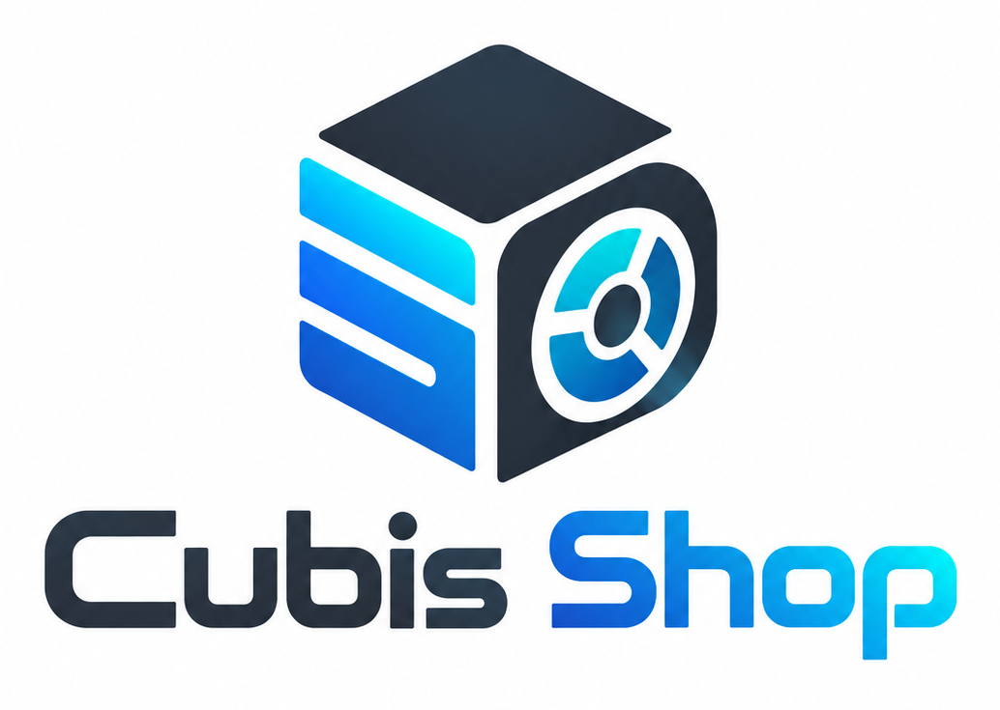
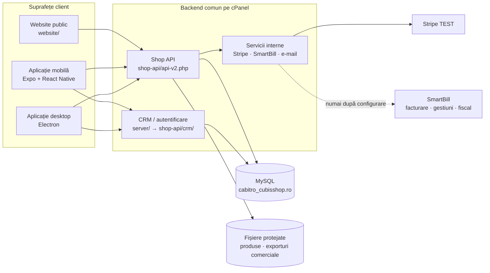

<div align="center">
  

  <h1>Cubis Shop</h1>

  <p><strong>Platformă omnichannel pentru magazin, operațiuni și integrare fiscală prin SmartBill.</strong></p>

  <p>
    <a href="docs/wiki/Home.md"><strong>Wiki complet</strong></a>
    ·
    <a href="docs/wiki/Architecture.md"><strong>Arhitectură</strong></a>
    ·
    <a href="docs/wiki/Local-Development.md"><strong>Pornire locală</strong></a>
    ·
    <a href="docs/wiki/Deployment.md"><strong>Deployment</strong></a>
    ·
    <a href="docs/wiki/Troubleshooting.md"><strong>Depanare</strong></a>
  </p>

  <p>
    
    
    
    
    
    <a href="LICENSE"></a>
  </p>
</div>


> [!IMPORTANT]
> **Starea operațională documentată la 9 octombrie 2026:** API-ul comun și baza MySQL izolată Cubis Shop sunt publicate controlat pe cPanel, iar Stripe funcționează exclusiv în modul TEST. Website-ul și aplicațiile nu sunt încă publicate/distribuite. E-mailul, emiterea SmartBill și automatizările externe rămân dezactivate până la configurarea și aprobarea explicită a identității Cubis. Vezi [raportul Etapei 3](docs/CUBIS_STAGE3_CPANEL_DEPLOYMENT_REPORT.md).

## Ce este Cubis Shop

Cubis Shop reunește într-un singur proiect patru suprafețe care folosesc aceeași sursă de adevăr:

| Suprafață | Tehnologie | Rol |
|---|---|---|
| **Aplicație mobilă** | Expo 57, React Native 0.86, TypeScript | administrare rapidă, dashboard, catalog, comenzi, documente SmartBill, configurări și notificări |
| **Aplicație desktop** | Electron 28, HTML/CSS/JavaScript | administrare completă pe Windows, exporturi, documente, actualizări și fluxuri operaționale ample |
| **Website public** | HTML/CSS/JavaScript static + date din API | catalog, produs, cont client, checkout, Stripe, urmărire, anulare și solicitare de retur |
| **Backend comun** | PHP 8.2+, MySQL/MariaDB | autentificare, catalog, clienți, comenzi, Stripe și integrarea SmartBill |

Platforma acoperă:

- catalog ierarhic, compatibilități, producători, surse, furnizori și până la 12 imagini/produs;
- prețuri, reduceri, promoții, recomandări comerciale și sincronizare tehnică Stripe;
- checkout, cont client, adrese, comenzi, istoric de status, notificări și tracking securizat;
- disponibilitate comercială și asocierea produselor cu gestiunile SmartBill;
- facturi, documente de corecție și transmitere fiscală gestionate prin SmartBill;
- sincronizare SmartBill read-only, urmată de emitere controlată numai după aprobare;
- retururi integrale sau parțiale, decizii pe poziție și sincronizarea efectului în SmartBill;
- dashboard, clienți, newsletter, date de firmă, puncte de recepție și utilizatori administrativi.

## Arhitectură pe scurt



```text
 +----------------+      +----------------------+      +----------------+
 | WEBSITE PUBLIC | ---> |  CUBIS SHOP API      | ---> |    SMARTBILL   |
 +----------------+      |----------------------|      |----------------|
                         | catalog + comenzi    |      | facturare      |
 +----------------+      | clienti + checkout   |      | gestiuni       |
 | APLICATIE MOBIL| ---> | Stripe + notificari |      | fiscalitate    |
 +----------------+      +----------+-----------+      +----------------+
                                    ^
 +----------------+                 |
 | DESKTOP ADMIN  | ----------------+
 +----------------+
```

Principiul central este simplu: **clienții nu se conectează direct la MySQL și nu primesc secrete server-side**. Website-ul folosește rute publice strict filtrate, iar aplicațiile administrative folosesc sesiuni autentificate. `CUBIS_API_KEY`, credențialele bazei, cheile Stripe, tokenurile SmartBill și parolele SMTP rămân exclusiv pe server.

O explicație detaliată, inclusiv granițele de încredere și fluxul datelor, este în [Arhitectură](docs/wiki/Architecture.md).

## Starea componentelor

| Componentă | Stare | Observație |
|---|---:|---|
| API Shop public/admin | ✅ publicat controlat | `https://cubisshop.ro/shop-api/api-v2.php` |
| API CRM/auth/service | ✅ publicat controlat | `https://cubisshop.ro/shop-api/crm/api.php` |
| MySQL Cubis izolat | ✅ migrat | baza acceptată de cod este exact `cabitro_cubisshop.ro` |
| Stripe | 🧪 TEST | cheile LIVE și evenimentele `livemode=true` sunt refuzate |
| Website | ⏸ nepublicat | conține încă material provenit din etapa de izolare; nu se publică în forma curentă |
| Aplicație mobilă | ⏸ nedistribuită | se poate rula local cu Expo |
| Aplicație desktop | ⏸ nedistribuită | buildul este manual, prin workflow sau local |
| SmartBill emitere / e-mail / automatizări | 🔒 dezactivate implicit | activarea necesită configurare și aprobare explicită |

## Pornire rapidă — aplicația Expo

### Cerințe

- Node.js **20 LTS**;
- npm (lockfile-ul este sursa versiunilor);
- Android Studio/emulator, Expo Go compatibil sau un dispozitiv fizic;
- acces la API-ul configurat pentru mediul folosit.

### Instalare

```bash
git clone https://github.com/CAB-IT-EXPERT/cubisshop.ro.git
cd cubisshop.ro
npm ci
```

Opțional, creează configurația locală pornind de la exemplu:

```powershell
Copy-Item .env.example .env
```

> [!CAUTION]
> Prefixul `EXPO_PUBLIC_` înseamnă că valoarea poate ajunge în bundle-ul client. Nu pune niciodată în el parole MySQL, `CUBIS_API_KEY`, chei Stripe secrete, tokenuri SmartBill sau parole SMTP.

Pornește dezvoltarea:

```bash
npm run dev
```

Comenzi uzuale:

```bash
npm run typecheck
npm run lint
npm run audit:theme
npm run audit:design
npm run build:web
```

Pentru explicații despre emulator, API local/remote, variabile și probleme frecvente, vezi [Dezvoltare locală](docs/wiki/Local-Development.md) și [Configurare](docs/wiki/Configuration.md).

## Rularea celorlalte suprafețe

### Desktop Electron

```bash
cd electron-app
npm ci
npm start
```

Build Windows:

```bash
npm run dist:win:ci
```

Artefactele sunt generate în `electron-app/release/` și sunt ignorate de Git. Publicarea oficială se face manual prin workflow-ul **Publicare Electron pentru Windows**, care cere un tag explicit.

### Website public — numai pentru previzualizare locală

```bash
python scripts/serve-website.py 4173
```

Apoi deschide `http://127.0.0.1:4173`.

> [!WARNING]
> Pornirea locală nu înseamnă că website-ul este pregătit pentru producție. Înainte de lansare trebuie înlocuit/validat conținutul rămas din etapa de izolare, configurată identitatea Cubis și parcurs checklistul din [Deployment](docs/wiki/Deployment.md).

### Backend PHP

Backend-ul țintește PHP **8.2+** cu extensiile `curl`, `dom`, `fileinfo`, `json`, `mbstring`, `openssl`, `pdo`, `pdo_mysql`, `simplexml`, `xml`, `xmlreader`, `xmlwriter` și `zip`. Verificarea se face din CLI:

```bash
php shop-api/check-php-extensions.php
```

Migrarea este intenționat protejată și rulează în mod dry-run dacă nu primește simultan `--apply` și confirmarea numelui exact al bazei:

```bash
php shop-api/migrate.php
php shop-api/migrate.php --apply --confirm=cabitro_cubisshop.ro
```

Nu rula comanda de aplicare înainte de backup, revizuirea planului și verificarea mediului. Citește [Planul de migrare](shop-api/migrations/MIGRATION_PLAN.md) și [Deployment](docs/wiki/Deployment.md).

## Structura repository-ului

```text
.
├── app/                    # rute Expo Router și deep links
├── components/             # dashboard și managerii aplicației mobile
├── contexts/               # autentificare și navigare globală
├── services/               # clienți TypeScript pentru CRM și Shop API
├── electron-app/           # aplicația desktop, preload, renderer, build și QA
├── website/                # storefront static, checkout, cont și pagini legale
├── shop-api/               # API magazin, Stripe și integrarea SmartBill
├── server/                 # CRM/auth/service; ambalat la deployment ca shop-api/crm/
├── scripts/                # preview, audit, generare și pachete de deployment
├── docs/                   # handoff-uri și rapoarte tehnice/fiscale
├── docs/wiki/              # wiki-ul complet, versionat împreună cu sursa
├── assets/                 # branding, iconuri și modele PDF
└── .github/workflows/      # publicarea manuală a aplicației Electron
```

## SmartBill este autoritatea contabilă și fiscală

<p align="center">
  
</p>

Cubis Shop gestionează experiența comercială, comenzile și interfețele operatorului. SmartBill gestionează facturarea, gestiunile, evidența contabilă și transmiterea fiscală. Cubis nu alocă independent serii/numere fiscale și nu dublează local mecanismele contabile SmartBill.

> [!NOTE]
> Auditul trebuie să distingă între cod prezent și funcție activă: emiterea facturii normale este deja direcționată prin SmartBill, iar scrierile contabile locale sunt blocate implicit. Prezența codului istoric în repository nu îl transformă într-un flux operațional.

```text
 [COMANDA CUBIS] -> [VALIDARE OPERATOR] -> [SMARTBILL] -> [DOCUMENT + STATUS]
         ^                                                       |
         +-------------------- sincronizare ---------------------+
```

Conectarea read-only, emiterea și e-mailul sunt porți separate. Retry-urile trebuie reconciliate înainte de repetare, pentru a nu dubla documentele. Vezi [Integrarea SmartBill](docs/wiki/SmartBill-Integration.md) și [Comenzi și retururi](docs/wiki/Orders-Returns-and-Refunds.md).

## Verificare și calitate

Înainte de commit:

```bash
npm run typecheck
npm run lint
npm run audit:theme
npm run audit:design
node scripts/test-public-theme.cjs
```

Pentru PHP, verifică mai întâi extensiile, apoi rulează lint și contractele relevante schimbării. Testele din `shop-api/tests/` sunt scripturi independente; unele au nevoie de `pdo_sqlite`, `mbstring`, `gd`, `zip`, fixture-uri sau configurare de integrare. Nu interpreta un test sărit din cauza runtime-ului drept validare funcțională.

Checklistul complet și matricea testelor sunt în [Testing și quality gates](docs/wiki/Testing-and-Quality.md).

## Documentație

| Dacă vrei să… | Citește |
|---|---|
| înțelegi proiectul în 10 minute | [Wiki Home](docs/wiki/Home.md) |
| vezi componentele și fluxurile dintre ele | [Arhitectură](docs/wiki/Architecture.md) |
| pornești proiectul local | [Dezvoltare locală](docs/wiki/Local-Development.md) |
| configurezi variabilele fără să expui secrete | [Configurare](docs/wiki/Configuration.md) |
| înțelegi mobilul, desktopul și website-ul | [Aplicații și suprafețe](docs/wiki/Applications-and-Surfaces.md) |
| lucrezi cu API-ul și datele | [API și model de date](docs/wiki/API-and-Data.md) |
| modifici o comandă, anulare sau retur | [Comenzi, retururi și rambursări](docs/wiki/Orders-Returns-and-Refunds.md) |
| lucrezi cu facturarea, gestiunile sau transmiterea fiscală | [Integrarea SmartBill](docs/wiki/SmartBill-Integration.md) |
| publici API-ul, site-ul sau aplicațiile | [Deployment](docs/wiki/Deployment.md) |
| rulezi testele corecte | [Testing și quality gates](docs/wiki/Testing-and-Quality.md) |
| verifici securitatea și operațiunile | [Securitate și operare](docs/wiki/Security-and-Operations.md) |
| rezolvi o problemă frecventă | [Depanare](docs/wiki/Troubleshooting.md) |
| contribui în siguranță | [Ghid de contribuție](docs/wiki/Contributing.md) |

## Contribuții

Înainte de orice schimbare:

1. citește `AGENTS.md` și documentația de domeniu aferentă;
2. pornește de pe un repository curat și nu suprascrie modificări care nu îți aparțin;
3. păstrează secretul în mediul serverului, nu în cod sau bundle-uri client;
4. adaugă/actualizează testele pentru contractul schimbat;
5. actualizează README/wiki dacă se schimbă arhitectura, configurarea sau pașii operaționali.

Detaliile sunt în [Contributing](docs/wiki/Contributing.md).

## Licență

Codul este distribuit sub [licența MIT](LICENSE). Datele comerciale, credențialele, certificatele, materialele clientului și identitățile de brand nu sunt implicit acordate prin licența codului.

---

<div align="center">
  <sub>Dezvoltat și întreținut de <strong>CAB IT EXPERT</strong>.</sub>
</div>
