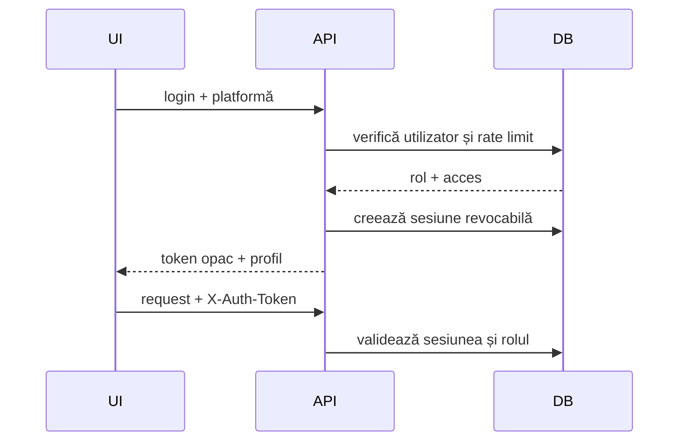

# API și model de date

[← Aplicații](Applications-and-Surfaces.md) · [Comenzi și retururi →](Orders-Returns-and-Refunds.md)

## Endpointuri

| Serviciu | URL documentat | Sursă |
|---|---|---|
| Shop API | `https://cubisshop.ro/shop-api/api-v2.php` | `shop-api/api-v2.php` → `api.php` |
| CRM/auth | `https://cubisshop.ro/shop-api/crm/api.php` | `server/api.php`, copiat ca `crm/` la build |
| Stripe webhook TEST | `api-v2.php?action=stripeWebhook` | Shop API |

## Rutare

Shop API folosește:

```text
HTTP METHOD + ?action=<actiune> + optional id/query + JSON body
```

`api-v2.php` este entrypointul stabil. Nu menține o a doua implementare divergentă.

## Rute publice

Categorii principale:

- catalog: listă, paginare, produs, filtre și recenzii;
- configurare publică: livrare, plată și promoții eligibile;
- client: înregistrare, login, profil, adrese și resetare;
- checkout: creare comandă, Stripe și rezultat;
- post-comandă: tracking, anulare eligibilă și cerere de retur.

„Public” înseamnă fără sesiune admin, nu fără protecții. Checkoutul validează termenii, recenzia verifică achiziția, iar trackingul folosește token sau combinația comandă + e-mail.

## Rute administrative

- dashboard și indicatori comerciali;
- produse, taxonomii, surse și furnizori;
- comenzi, clienți și newsletter;
- reduceri, livrări și plăți;
- date de firmă și utilizatori;
- exporturi;
- conectivitate, referințe și emitere SmartBill.

Rutele admin cer sesiune și rol. `CUBIS_API_KEY` este numai pentru operații server-to-server/health controlat, nu pentru JavaScript sau aplicații.

## Autentificare admin



Loginul are limită de încercări, iar ultimul administrator activ nu poate fi șters. Clientul final și utilizatorul admin sunt identități diferite.

## Răspunsuri și erori

Clienții separă:

```text
2xx  succes
4xx  validare / autentificare / conflict de stare
5xx  server sau integrator
0    retea / timeout / raspuns imposibil de citit
```

Un răspuns HTML în loc de JSON indică frecvent redirect, proxy/WAF sau eroare PHP de hosting. Nu afișa stack trace, query-uri sau tokenuri.

## Domenii de date Cubis

### Identitate și acces

Utilizatori admin, sesiuni, roluri, acces pe platforme, clienți și adrese.

### Catalog

Produse, imagini, categorii, compatibilități, producători, surse, recenzii, promoții și asocierea SKU cu SmartBill.

### Comerț

Metode de plată/livrare, comenzi, poziții, statusuri, dovezi de acceptare, retururi, notificări și evenimente Stripe.

### Integrare

Setări fără secret în client, identificatori SmartBill, stări de sincronizare, audit și rezultate filtrate.

SmartBill rămâne autoritatea pentru documentele și evidența fiscală. Cubis păstrează numai datele operaționale și legăturile necesare experienței comerciale.

Auditarea unor tabele sau funcții locale istorice nu demonstrează utilizarea lor. Pentru a declara o funcție activă trebuie demonstrată ruta, configurația și efectul runtime; pentru emiterea normală, ruta activă este SmartBill.

## Convenții de modelare

- ID-urile sunt stabile și nu se refolosesc;
- comanda păstrează snapshotul comercial al pozițiilor;
- istoricul de status este separat de statusul curent;
- mutațiile cu efect extern au cheie idempotentă;
- `row_version`/lockurile protejează concurența unde este necesar;
- tokenurile și secretele nu apar în DTO;
- identificatorul SmartBill se salvează pentru reconciliere;
- un timeout extern nu este interpretat automat ca eșec.

## Tranzacții și outbox

Pentru o operație cu efect extern:

```text
BEGIN
  validate actor + state
  save local intent
  reserve idempotency key
  create integration job/outbox
COMMIT

worker/request -> SmartBill
response       -> update linked state
```

Nu ține o tranzacție MySQL deschisă pe durata unui request extern lent dacă poți folosi outbox/reconciliere.

## Migrare

Migrarea este CLI-only și dry-run implicit:

```powershell
php shop-api/migrate.php
php shop-api/migrate.php --apply --confirm=cabitro_cubisshop.ro
```

API-ul verifică numele exact al bazei și `SELECT DATABASE()`. Pentru baza nouă urmează [planul de migrare](https://github.com/CAB-IT-EXPERT/cubisshop.ro/blob/main/shop-api/migrations/MIGRATION_PLAN.md), nu toate fișierele istorice în ordine arbitrară.

## Schimbarea unui contract API

- [ ] acțiune și metodă HTTP clare;
- [ ] autorizare înainte de acces la date;
- [ ] validare completă a inputului;
- [ ] răspuns minim, fără secrete;
- [ ] cod HTTP corect;
- [ ] idempotency pentru retry;
- [ ] tip TypeScript actualizat;
- [ ] client mobil actualizat;
- [ ] client desktop actualizat;
- [ ] website actualizat dacă ruta este publică;
- [ ] test de contract și test de autorizare;
- [ ] wiki actualizat.

## Performanță

- paginează listele mari;
- indexează filtrele folosite frecvent;
- folosește payload compact pentru catalog;
- nu returna imagini base64 în liste;
- estimează exporturile mari înainte de generare;
- cache-uiește numai date care pot fi invalidate sigur;
- măsoară înainte de a crește limitele.
