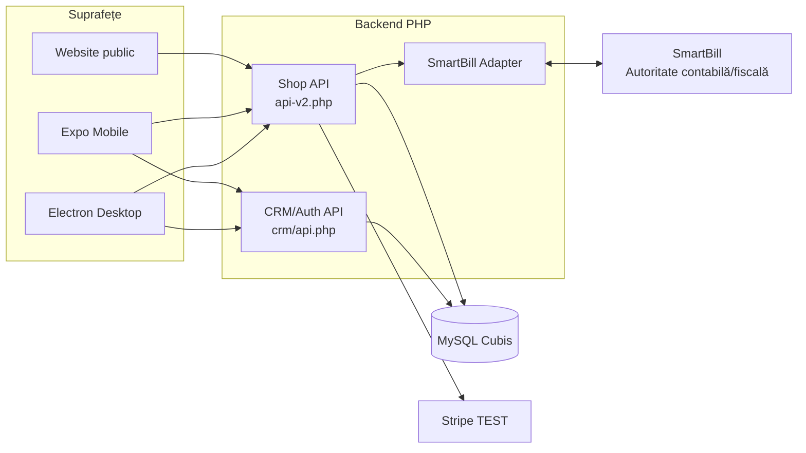
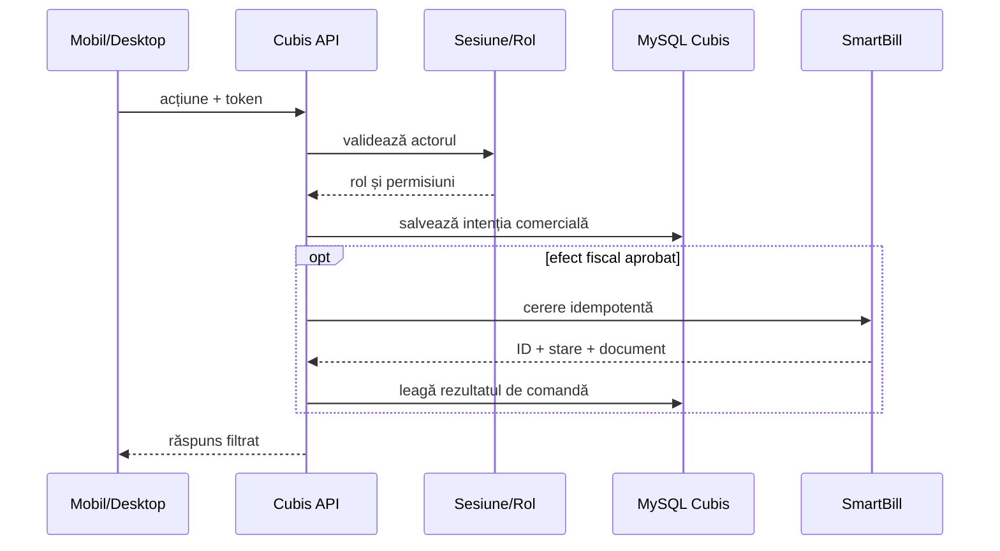

# Arhitectură

[← Wiki](Home.md) · [Dezvoltare locală →](Local-Development.md)

## Principiul de bază

Cubis Shop este stratul comercial și operațional. SmartBill este stratul contabil și fiscal. Cele două comunică prin API, cu porți separate pentru citire, emitere și e-mail.

> [!IMPORTANT]
> Arhitectura se descrie după traseul runtime, nu după simpla existență a unor fișiere. Emiterea normală trece prin SmartBill. Codul contabil local rămas în surse este dormant în traseul activ, iar scrierile sale sunt blocate implicit.

## Diagramă ASCII completă

```text
  UTILIZATORI PUBLICI                              OPERATORI AUTENTIFICATI
  ===================                              =======================
          |                                               |         |
          v                                               v         v
 +------------------+                           +-------------+ +-------------+
 | WEBSITE STATIC   |                           | EXPO MOBILE | | ELECTRON    |
 |------------------|                           |-------------| |-------------|
 | catalog          |                           | dashboard   | | administrare|
 | produs           |                           | comenzi     | | exporturi   |
 | cont + checkout  |                           | catalog     | | update app  |
 | tracking/retur   |                           +------+------+ +------+
 +--------+---------+                                  |               |
          |                                            +-------+-------+
          |                                                    |
          v                                                    v
 +------------------------------------------------------------------------+
 |                         CUBIS SHOP API                                 |
 |------------------------------------------------------------------------|
 | api-v2.php               | crm/api.php                                |
 | catalog + clienti        | autentificare + utilizatori                |
 | checkout + comenzi       | sesiuni + roluri                           |
 | Stripe TEST              | CRM/service                                |
 | integrare SmartBill      |                                            |
 +----------+-----------------------------+-------------------------------+
            |                             |
            v                             v
 +----------------------+      +---------------------------+
 | MYSQL CUBIS          |      | SMARTBILL                 |
 |----------------------|      |---------------------------|
 | date operationale    |      | facturare si documente   |
 | catalog + clienti    |      | gestiuni + contabilitate |
 | comenzi + statusuri  |      | transmitere fiscala      |
 | sesiuni + audit      |      | stare autoritativa       |
 +----------------------+      +---------------------------+
            |
            v
 +----------------------+
 | STORAGE PROTEJAT     |
 | imagini + exporturi  |
 +----------------------+
```

## Diagramă Mermaid



## Componentele principale

### Aplicația mobilă

Intrarea este `app/_layout.tsx`. Expo Router încarcă suprafața principală din `app/(tabs)/_layout.tsx`, iar `components/ShopModuleScreen.tsx` orchestrează dashboardul și managerii de business.

Clienții API sunt centralizați:

- `services/api.ts` — autentificare/CRM;
- `services/shopApi.ts` — catalog, comenzi, configurări și SmartBill.

`contexts/AuthContext.tsx` gestionează sesiunea, iar datele sensibile ale sesiunii folosesc storage-ul sigur al platformei.

### Aplicația desktop

```text
[main.js] <---- IPC permis ----> [preload.js] <---- API limitat ----> [renderer]
    |                                                                     |
    +-- fereastra / fisiere / updater                                     +-- HTTP
```

- `main.js` controlează fereastra, protocolul `cubisshop://`, salvarea fișierelor și updaterul;
- `preload.js` expune doar operațiile aprobate;
- `renderer/js/api.js` comunică cu CRM/auth;
- `renderer/js/shop-api.js` comunică cu Shop API;
- `shop-catalog.js` și `shop-commerce.js` implementează UI-ul de administrare.

Rendererul nu primește acces Node arbitrar.

### Website-ul

`website/` este static și consumă exclusiv rute publice. El include catalog, produs, checkout, cont, rezultat plată, tracking, solicitare de retur și pagini legale.

Website-ul este o suprafață neîncrezută: nu primește token admin, cheia master sau credentiale SmartBill.

### Backend-ul

`shop-api/api-v2.php` este endpointul stabil și încarcă implementarea din `shop-api/api.php`. API-ul CRM/auth are sursa în `server/`; builderul cPanel îl copiază ca `shop-api/crm/`.

Serviciile relevante pentru arhitectura țintă:

| Componentă | Responsabilitate |
|---|---|
| `stripe.php` | sesiuni, webhook semnat, retry și idempotency |
| `smartbill-service.php` | conexiune, referințe, emitere controlată și reconciliere |
| `order-cancellation.php` | regulile comerciale ale anulării |
| `order-return.php` | eligibilitate și cereri de retur |
| `order-emails.php` | comunicări comerciale controlate |
| `product-*` | preț, căutare, pagină și export |

## Frontiere de încredere

| Frontieră | Permis | Interzis |
|---|---|---|
| website → API public | catalog, checkout, token tracking | token admin, cheia master |
| mobil/desktop → API admin | token sesiune și payload validat | parole DB și tokenuri SmartBill |
| API → MySQL | query-uri și tranzacții server-side | conexiune directă din client |
| API → Stripe | chei TEST server-side | chei LIVE în etapa curentă |
| API → SmartBill | credentiale criptate server-side | tokenuri în UI/log |
| renderer → sistem | operații punctuale prin preload | acces Node general |

## Fluxul unei operații administrative



## Surse de adevăr

| Domeniu | Autoritate |
|---|---|
| catalog public și conținut | Cubis Shop |
| client, comandă, status comercial | Cubis Shop |
| plată card confirmată | Stripe, reflectată în Cubis |
| utilizatori și sesiuni admin | Cubis Shop |
| facturi, serii și documente fiscale | SmartBill |
| gestiuni și evidență contabilă | SmartBill |
| transmitere fiscală | SmartBill |

La neconcordanță, nu „reparăm” datele SmartBill printr-un calcul local paralel; reconciliem identificatorii și starea prin integrare.

## Idempotency

Operațiile externe trebuie să respecte:

```text
aceeasi intentie + aceeasi cheie  => acelasi rezultat
alta intentie   + aceeasi cheie  => conflict
raspuns incert                  => verificare inainte de retry
```

Acest contract protejează plata, emiterea SmartBill, notificările și modificările de status împotriva dublării.

## Decizii de design

- un singur endpoint Shop API stabil pentru toate suprafețele;
- migrarea este CLI-only și dry-run implicit;
- SmartBill este sistemul fiscal/contabil autoritativ;
- integrările externe au porți explicite;
- configurațiile locale și secretele nu sunt versionate;
- release-ul desktop este manual, cu tag explicit;
- starea de publicare a website-ului este independentă de starea API-ului.
