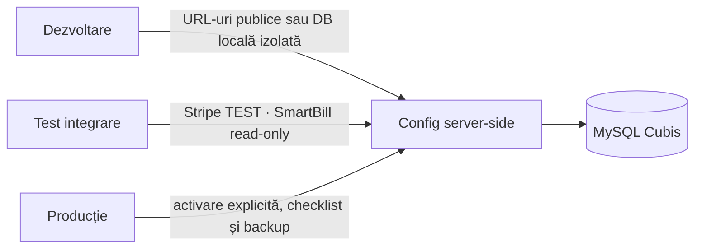

# Configurare

[← Dezvoltare locală](Local-Development.md) · [Aplicații →](Applications-and-Surfaces.md)

## Principiul principal

Configurația este împărțită în două clase:

1. **valori publice de client**, care pot apărea în bundle-uri;
2. **secrete server-side**, care nu au voie în Git, Expo, Electron renderer sau website.

Prefixul `EXPO_PUBLIC_` este o declarație de expunere, nu o protecție.

## Variabile client

| Variabilă | Consumator | Conținut permis |
|---|---|---|
| `EXPO_PUBLIC_API_URL` | aplicația Expo | URL-ul public al CRM/auth API |
| `EXPO_PUBLIC_SHOP_API_URL` | aplicația Expo | baza URL publică Shop API |
| `EXPO_PUBLIC_SUPABASE_URL` | cod legacy/opțional | URL public, dacă integrarea este folosită |
| `EXPO_PUBLIC_SUPABASE_ANON_KEY` | cod legacy/opțional | numai cheia anonimă publicabilă |

În codul actual, `services/api.ts` are URL-ul CRM implicit explicit, iar `services/shopApi.ts` permite suprascrierea bazei Shop API prin mediu.

## Variabile server-side

### Bază și acces

| Variabilă | Rol | Regulă |
|---|---|---|
| `CUBIS_API_KEY` | operații server-to-server/health protejat | secret aleator de minimum 32 bytes |
| `CUBIS_ALLOWED_ORIGINS` | allowlist CORS | origini explicite, niciodată `*` pentru admin |
| `CUBIS_DB_HOST` | host MySQL | numai server |
| `CUBIS_DB_PORT` | port MySQL | implicit 3306 dacă hostingul confirmă |
| `CUBIS_DB_NAME` | numele bazei | exact `cabitro_cubisshop.ro` |
| `CUBIS_DB_USER` | utilizator MySQL | numai server |
| `CUBIS_DB_PASS` | parolă MySQL | numai server |

API-ul verifică `SELECT DATABASE()` și refuză altă bază. Aceasta protejează izolarea față de proiectele sursă/vecine.

### Stripe

| Variabilă | Etapa curentă |
|---|---|
| `CUBIS_STRIPE_SECRET_KEY` | numai `sk_test_...` |
| `CUBIS_STRIPE_PUBLISHABLE_KEY` | numai `pk_test_...` |
| `CUBIS_STRIPE_WEBHOOK_SECRET` | secretul endpointului TEST |

Codul refuză chei LIVE, evenimente `livemode=true`, sesiuni fără prefixul proiectului și metadata fără `cubisshop_project=cubisshop`.

### SmartBill

| Variabilă | Rol |
|---|---|
| `CUBIS_SMARTBILL_V1_EMAIL` | identitate API V1 |
| `CUBIS_SMARTBILL_V1_TOKEN` | token API V1 |
| `CUBIS_SMARTBILL_V3_TOKEN` | token API V3 |
| `CUBIS_SMARTBILL_CIF` | CIF-ul firmei |
| `CUBIS_SMARTBILL_CREDENTIAL_KEY` | cheie AES-256-GCM, minimum 32 caractere |
| `CUBIS_SMARTBILL_READ_ENABLED` | permite doar conectivitate/citire |
| `CUBIS_SMARTBILL_ISSUING_ENABLED` | poartă separată pentru emitere |
| `CUBIS_SMARTBILL_EMAIL_ENABLED` | poartă separată pentru e-mail fiscal |

Credențialele setate în mediul serverului au prioritate față de seiful criptat din DB. Nu porni emiterea și e-mailul doar pentru că testul de conexiune read-only funcționează.

### Storage și URL-uri publice

| Variabilă | Rol |
|---|---|
| `CUBIS_INVOICE_STORAGE_DIR` | cale absolută pentru facturi |
| `CUBIS_INVOICE_PUBLIC_BASE_URL` | URL public controlat pentru facturi |
| `CUBIS_SHIPPING_NOTE_STORAGE_DIR` | cale absolută pentru avize |
| `CUBIS_SHIPPING_NOTE_PUBLIC_BASE_URL` | URL public controlat pentru avize |

Storage-ul trebuie să fie neexecutabil și protejat. URL-ul public nu înlocuiește verificarea autorizării la generare/obținere.

### Integrări publice și comunicare

- `CUBIS_GOOGLE_ANALYTICS_MEASUREMENT_ID`;
- `CUBIS_GOOGLE_CUSTOMER_REVIEWS_MERCHANT_ID`;
- `CUBIS_GOOGLE_SEARCH_CONSOLE_VERIFICATION`;
- `CUBIS_INDEXNOW_KEY`;
- `CUBIS_WHATSAPP_GRAPH_VERSION`;
- `CUBIS_WHATSAPP_PHONE_NUMBER_ID`;
- `CUBIS_WHATSAPP_ACCESS_TOKEN`.

Absența valorilor trebuie tratată ca „integrare neconfigurată”, nu ca motiv pentru a recupera identificatori din alt proiect.

## Fișiere locale

Fișierele uzuale sunt:

- `shop-api/config.local.php`;
- `server/api_config.local.php` sau, în pachet, `shop-api/crm/api_config.local.php`;
- `shop-api/gomag.local.php`, dacă integrarea este folosită controlat.

Modelele versionate sunt `shop-api/config.example.php`, `server/api_config.example.php` și `shop-api/gomag.local.example.php`.

`.gitignore` exclude `**/*.local.php`, `.env` și `**/*.secret.*`. `.htaccess` blochează accesul HTTP la configurații. Niciuna dintre aceste protecții nu justifică introducerea secretelor într-un fișier urmărit.

## Configurație pe medii

Nu deduce mediul din domeniu sau din existența unei chei. Porțile Stripe și SmartBill trebuie confirmate explicit.

## Checklist înainte de activarea unei integrări

- [ ] identitatea firmei este completă și verificată;
- [ ] secretul este salvat numai server-side;
- [ ] baza selectată este exact cea Cubis;
- [ ] testul de conectivitate trece în mediul de test;
- [ ] operația este idempotentă și are audit;
- [ ] erorile nu includ tokenuri sau payloaduri sensibile;
- [ ] există rollback/dezactivare;
- [ ] există aprobarea explicită pentru efectul extern;
- [ ] documentația și runbook-ul sunt actualizate.

## Rotirea secretelor

La suspiciune de expunere:

1. dezactivează integrarea afectată;
2. rotește secretul la furnizor;
3. actualizează mediul serverului;
4. invalidează sesiunile/tokenurile dacă este relevant;
5. verifică logurile fără a copia secretele în ticket/commit;
6. rulează testul de conectivitate;
7. reactivează numai funcția aprobată.

Ștergerea secretului din ultimul commit nu îl elimină din istoric. Dacă a fost versionat, tratează-l ca expus chiar dacă repository-ul este privat.
