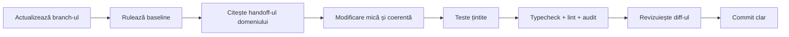

# Dezvoltare locală

[← Arhitectură](Architecture.md) · [Configurare →](Configuration.md)

## 1. Cerințe recomandate

| Instrument | Versiune/rol |
|---|---|
| Git | versiune recentă |
| Node.js | 20 LTS, aceeași familie folosită în GitHub Actions |
| npm | inclus cu Node; folosește `npm ci` |
| Python | 3.x pentru serverele de preview și verificări auxiliare |
| PHP | 8.2+ pentru backend și testele PHP |
| Android Studio / Expo Go | numai pentru rularea mobilă |
| PowerShell 7 | recomandat pe Windows pentru scripturile `.ps1` |

Extensiile PHP obligatorii pe server sunt: `curl`, `dom`, `fileinfo`, `json`, `mbstring`, `openssl`, `pdo`, `pdo_mysql`, `simplexml`, `xml`, `xmlreader`, `xmlwriter`, `zip`. Pentru testele locale și randare sunt utile și `pdo_sqlite`, `gd`, `intl` și `bcmath`.

## 2. Clone și instalare

```powershell
git clone https://github.com/CAB-IT-EXPERT/cubisshop.ro.git
Set-Location cubisshop.ro
npm ci
```

Verifică imediat baseline-ul:

```powershell
npm run typecheck
npm run lint
```

Dacă aceste comenzi eșuează înaintea modificării, păstrează rezultatul și separă problema existentă de regresia ta.

## 3. Configurare locală

```powershell
Copy-Item .env.example .env
```

Pentru aplicația Expo, variabilele relevante sunt:

```dotenv
EXPO_PUBLIC_API_URL=https://cubisshop.ro/shop-api/crm/api.php
EXPO_PUBLIC_SHOP_API_URL=https://cubisshop.ro/shop-api
```

Nu completa valorile `CUBIS_*` într-un mediu client. Ele sunt listate în `.env.example` ca checklist operațional pentru server. Vezi [Configurare](Configuration.md).

## 4. Aplicația mobilă

Pornește Metro/Expo:

```powershell
npm run dev
```

Din terminalul Expo poți deschide:

- Android emulator;
- web, pentru verificări rapide de layout;
- un dispozitiv compatibil prin mecanismul Expo disponibil.

Observații:

- schema deep-link este `cubisshop://`;
- `app/order/[id].tsx` tratează deschiderea directă a unei comenzi;
- aplicația are `runtimeVersion` legată de versiunea aplicației;
- Expo Updates este dezactivat în `app.json`, deci nu presupune OTA activ.

### Când API-ul local nu este pe aceeași mașină logică

`localhost` din emulator/dispozitiv nu înseamnă întotdeauna PC-ul de dezvoltare. Folosește o adresă accesibilă din acel dispozitiv și configurează explicit URL-urile publice. Nu dezactiva TLS/CORS în cod pentru a masca o problemă de rețea.

## 5. Aplicația desktop

Aplicația desktop are propriul lockfile și propriile dependențe:

```powershell
Set-Location electron-app
npm ci
npm start
```

Revino în rădăcină cu `Set-Location ..`.

Build Windows fără publicare:

```powershell
Set-Location electron-app
npm run dist:win:ci
```

Rezultatul ajunge în `electron-app/release/`. Directorul este ignorat de Git.

## 6. Website-ul

Preview simplu:

```powershell
python scripts/serve-website.py 4173
```

URL: `http://127.0.0.1:4173`.

Preview pentru experiența și e-mailurile de comandă:

```powershell
python scripts/serve-order-previews.py
```

URL implicit: `http://127.0.0.1:4174`.

Pentru unele preview-uri, scripturile pot genera fișiere în directoare ignorate. Nu adăuga artefactele temporare în Git.

## 7. Backend PHP

Verifică runtime-ul:

```powershell
php shop-api/check-php-extensions.php
```

Lint pentru fișierele PHP urmărite:

```powershell
git ls-files "*.php" | ForEach-Object { php -l $_ }
```

### Bază locală

Backend-ul refuză o bază cu alt nume decât `cabitro_cubisshop.ro`. Pentru o instanță locală izolată:

1. creează baza cu numele exact;
2. configurează `CUBIS_DB_*` în mediul PHP sau într-un `config.local.php` ignorat;
3. rulează dry-run-ul;
4. verifică planul;
5. aplică numai pe baza locală confirmată.

```powershell
php shop-api/migrate.php
php shop-api/migrate.php --apply --confirm=cabitro_cubisshop.ro
```

Nu copia configurația producției și nu folosi date reale în teste locale.

## 8. Comenzi de calitate

```powershell
npm run typecheck
npm run lint
npm run audit:theme
npm run audit:design
node scripts/test-public-theme.cjs
node website/tests/google_integrations_disabled_contract_test.cjs
```

Contract PHP individual:

```powershell
php shop-api/tests/order_status_transition_test.php
```

Alege testele după domeniul modificat. Unele teste au precondiții de extensii sau configurare și trebuie interpretate conform mesajului lor, nu doar codului de ieșire agregat.

## 9. Ciclu recomandat de lucru



## 10. Curățenie locală

Directoarele de build/cache sunt deja ignorate: `node_modules/`, `.expo/`, `dist/`, `output/`, `outputs/`, `reports/`, `tmp/`, `electron-app/release/`. Nu șterge sau reseta fișiere care nu îți aparțin doar pentru a obține un status curat; inspectează `git status` și păstrează modificările existente ale colegilor.
