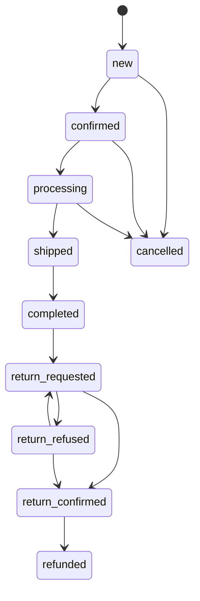
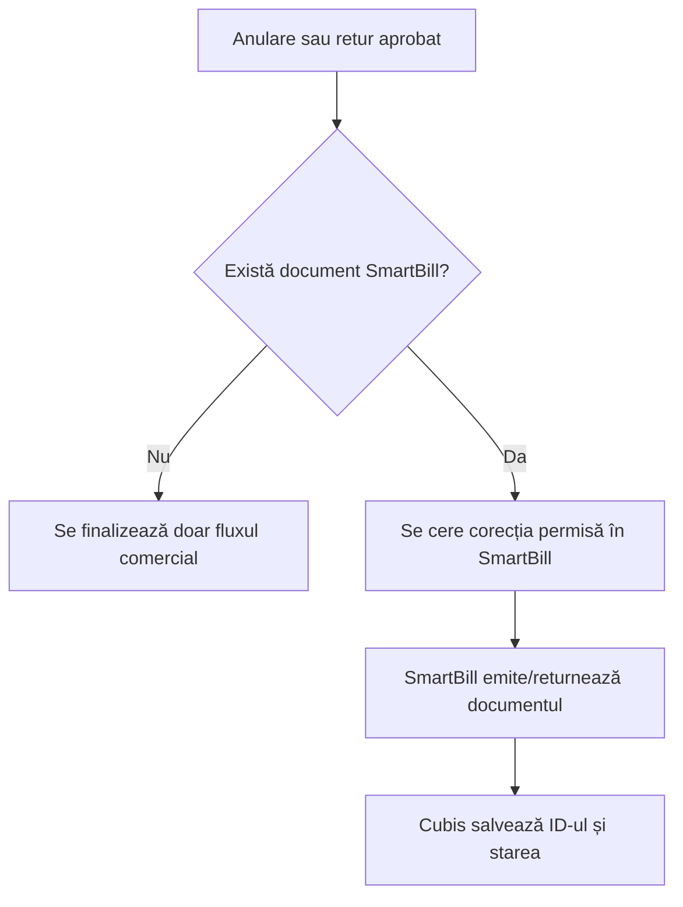

# Comenzi, anulări, retururi și rambursări

[← API și date](API-and-Data.md) · [SmartBill →](SmartBill-Integration.md)

## Separarea responsabilităților

Cubis Shop controlează fluxul comercial al comenzii. SmartBill controlează documentele și efectul fiscal.

```text
 CUBIS SHOP                              SMARTBILL
 ---------------------------             --------------------------
 eligibilitate anulare/retur   ------->  document fiscal necesar
 status comercial              <-------  ID + serie/numar + stare
 comunicare cu operatorul                evidenta autoritativa
```

## Ciclul comenzii



Statusurile normale avansează, nu se mută înapoi. Înainte de confirmarea returului, `return_requested` și `return_refused` pot alterna controlat. După `return_confirmed`, continuarea este `refunded`.

## Anulare publică și administrativă

| Regulă | Client | Operator |
|---|---|---|
| status public permis | `new`, `confirmed`, `processing` | poate interveni și ulterior, cu motiv |
| motiv | prin fluxul public | obligatoriu |
| după predarea curierului | buton ascuns și API refuză public | decizie administrativă auditată |
| deja anulată/rambursată | fără repetarea efectului | fără repetarea efectului |

API-ul verifică statusul chiar dacă UI-ul ascunde acțiunea.

## Efectul fiscal prin SmartBill



Cubis nu șterge, nu renumerotează și nu recreează independent documentele SmartBill. La timeout verifică mai întâi dacă documentul există, apoi decide retry-ul cu aceeași cheie idempotentă.

## Eligibilitatea returului public

Returul public este disponibil numai pentru o comandă `completed`, în termen și fără un flux incompatibil deja început.

| Cumpărător | Perioadă documentată | Regim |
|---|---:|---|
| PF/B2C, zilele 1–14 | 14 zile de la livrare | drept legal de retragere |
| PF/B2C, zilele 15–30 | extensie până la 30 zile | beneficiu comercial |
| PJ/B2B | 14 zile | beneficiu comercial voluntar |

Garanția/neconformitatea este un flux separat.

## Asocierea cererii

Formularul public independent cere inițial:

- numărul comenzii;
- e-mailul folosit la comandă.

După asocierea exactă afișează produsele eligibile, termenul și condițiile. Nu folosește numele clientului sau numărul facturii ca secret de acces.

## Retur parțial

Clientul poate selecta unul, mai multe sau toate produsele și o cantitate mai mică decât cea cumpărată. Cererea păstrează snapshotul denumirii, SKU-ului, cantității și valorii comerciale.

Operatorul decide pe fiecare poziție:

```text
[ACCEPTAT]    cantitate integrală
[PARTIAL]     cantitate acceptată < solicitată
[REFUZAT]     cantitate 0 + motiv obligatoriu
```

Confirmarea este blocată până când toate pozițiile au o decizie și există cel puțin o cantitate acceptată. Un refuz integral nu solicită document fiscal.

## Date bancare și dovadă

Pentru rambursare se colectează titularul și IBAN-ul, validate structural. Pentru PF, retragerea poate fi fără motiv declarat; pentru PJ, motivul rămâne necesar verificării comerciale.

Declarația, data și ora solicitării se păstrează, iar confirmarea prin e-mail oferă dovadă durabilă.

## Calcul comercial

```text
 produse acceptate
 + livrare initiala, numai cand regula o permite
 - cost direct de retur suportat de client
 = suma estimata pentru rambursare
```

Costul returului se copiază la momentul cererii. Schimbarea ulterioară a metodei de livrare nu modifică cererea existentă.

Livrarea standard inițială se include numai la returul integral B2C comunicat în primele 14 zile, nu la retur parțial, extensia comercială sau B2B.

## Confirmarea returului

1. Cubis verifică toate deciziile pe poziții.
2. Cubis calculează cantitățile comerciale acceptate.
3. Dacă există document fiscal, Cubis solicită corecția în SmartBill.
4. SmartBill returnează identificatorul și documentul autoritativ.
5. Cubis leagă rezultatul de comandă și afișează starea.
6. Operatorul/clientul primesc comunicarea configurată.
7. `refunded` finalizează rambursarea fără a repeta operația SmartBill.

## E-mailuri

- cererea publică trimite confirmarea de primire;
- pentru cererea introdusă manual, operatorul decide notificarea;
- confirmarea/refuzul au mesaje distincte;
- documentul SmartBill și mesajul comercial nu trebuie confundate;
- retrimiterea este explicită și auditată.

## Teste obligatorii

Testează:

- PF și PJ;
- anulare în fiecare status relevant;
- retur integral și parțial;
- limitele de 14/30 zile;
- IBAN invalid/valid;
- costul returului și livrarea inițială;
- document SmartBill absent/prezent;
- emitere oprită/activă;
- timeout + reconciliere;
- retry fără duplicare;
- mobil și desktop.

Contracte existente utile: `order_status_transition_test.php`, `order_cancellation_test.php`, `order_return_request_test.php`, `order_return_confirmation_test.php` și `partial_return_email_test.php`.
