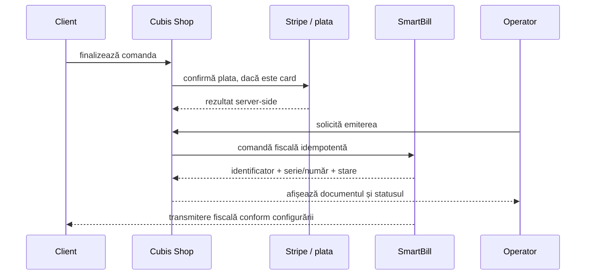

<div align="center">
  
  <h1>Integrarea SmartBill</h1>
  <p><strong>Sistemul autoritativ pentru facturare, gestiune, stoc contabil și transmiterea fiscală.</strong></p>
</div>

[← Comenzi și retururi](Orders-Returns-and-Refunds.md) · [Deployment →](Deployment.md)

## Decizia de arhitectură

Cubis Shop administrează experiența comercială — catalogul public, clienții, checkoutul, comenzile și interfața operatorului. SmartBill administrează domeniul contabil și fiscal:

## Ce este activ și ce este doar prezent în cod

```text
[COD PREZENT]      fisier/functie detectata de audit
[RUTA ACTIVA]      apelata efectiv de UI/API cu poarta deschisa
[AUTORITATE]       sistemul care decide si pastreaza rezultatul oficial
```

- emiterea facturii normale din Cubis trece deja prin SmartBill;
- SmartBill este autoritatea pentru documentul rezultat;
- codul contabil local istoric poate fi încă prezent în repository;
- scrierile locale respective sunt blocate implicit;
- un audit static trebuie să raporteze această diferență și să nu numească acel cod „funcție activă”.

Această separare previne două erori: activarea accidentală a unui flux paralel și documentarea unei capabilități dormante ca realitate operațională.

```text
 +---------------------------+          +---------------------------+
 |        CUBIS SHOP         |          |         SMARTBILL         |
 |---------------------------|          |---------------------------|
 | catalog si prezentare     |          | facturi si documente      |
 | clienti si checkout       |   API    | gestiuni                  |
 | comenzi si statusuri      +--------->| stoc contabil             |
 | operare mobil + desktop   |<---------+ transmitere fiscala       |
 | notificari comerciale     |  status  | rapoarte contabile        |
 +---------------------------+          +---------------------------+
              |
              v
 +---------------------------+
 | Website / Mobil / Desktop |
 +---------------------------+
```

Consecințele acestei decizii:

- Cubis nu implementează ca autoritate proprie registrele și calculele contabile;
- Cubis nu transmite direct documentele fiscale;
- documentele fiscale și transmiterea lor sunt gestionate prin SmartBill;
- Cubis poate păstra identificatori, legături, cache și stări de sincronizare necesare UI-ului;
- la neconcordanță, SmartBill este sursa de adevăr pentru datele contabile/fiscale.

## Limita responsabilităților

| Domeniu | Cubis Shop | SmartBill |
|---|---:|---:|
| catalog public, descrieri, imagini | autoritate | referință eventuală |
| preț comercial afișat | autoritate comercială | primește datele necesare documentului |
| checkout și plată | autoritate operațională | primește efectul fiscal |
| comandă și status comercial | autoritate | referință prin identificatori |
| emitere factură/storno | solicită și afișează rezultatul | **autoritate** |
| serie și număr fiscal | nu alocă independent | **autoritate** |
| gestiune și stoc contabil | nu calculează independent | **autoritate** |
| cost contabil | nu calculează independent | **autoritate** |
| transmitere fiscală | nu comunică direct | **gestionată prin SmartBill** |
| PDF/document fiscal final | afișează/descarcă | **generează/furnizează** |

## Porți de activare

Integrarea păstrează activările separate, astfel încât testul de conectivitate să nu emită accidental documente:

| Poartă | Efect |
|---|---|
| `CUBIS_SMARTBILL_READ_ENABLED` | permite verificarea și sincronizarea read-only |
| `CUBIS_SMARTBILL_ISSUING_ENABLED` | permite solicitarea emiterii documentelor |
| `CUBIS_SMARTBILL_EMAIL_ENABLED` | permite acțiunile de e-mail fiscal configurate |

Ordinea sigură este:

```text
[1] credentiale -> [2] test conexiune -> [3] read-only -> [4] reconciliere
       -> [5] aprobare explicita emitere -> [6] emitere controlata
```

Nu activa emiterea doar pentru că referințele read-only se sincronizează.

## Credențiale

SmartBill folosește valori exclusiv server-side:

- `CUBIS_SMARTBILL_V1_EMAIL`;
- `CUBIS_SMARTBILL_V1_TOKEN`;
- `CUBIS_SMARTBILL_V3_TOKEN`;
- `CUBIS_SMARTBILL_CIF`;
- `CUBIS_SMARTBILL_CREDENTIAL_KEY`.

Cheia de criptare are minimum 32 de caractere și rămâne în mediul serverului. Dacă datele sunt configurate din interfața administrativă, ele se salvează într-un payload AES-256-GCM. Tokenurile nu sunt returnate aplicațiilor.

Valorile definite direct în mediul serverului au prioritate față de seiful criptat din baza de date.

## Gestiuni și produse

SmartBill este autoritatea pentru lista gestiunilor. Cubis păstrează asocierea necesară dintre produsul comercial și identificatorul/SKU-ul folosit în SmartBill.

Reguli:

1. sincronizează gestiunile read-only;
2. alege explicit gestiunea pentru fiecare produs;
3. nu aplica automat o singură gestiune întregului catalog;
4. validează SKU-ul înainte de asociere;
5. afișează operatorului starea legăturii și ultima sincronizare;
6. nu suprascrie în Cubis stocul contabil calculat de SmartBill.

## Fluxul unei comenzi



Cubis trebuie să păstreze o cheie stabilă pentru aceeași cerere și să nu dubleze emiterea la timeout/retry. Dacă răspunsul este incert, întâi interoghează starea din SmartBill.

## Anulare și retur

Cubis decide eligibilitatea și starea comercială a comenzii. SmartBill execută documentul fiscal corespunzător.

```text
 [Anulare / retur aprobat in Cubis]
                  |
                  v
 [Exista document fiscal in SmartBill?] -- nu --> [fara document de corectie]
                  |
                 da
                  v
 [Solicitare storno / document de retur in SmartBill]
                  |
                  v
 [Cubis salveaza ID-ul si starea, fara numerotare proprie]
```

Cubis nu șterge sau renumerotează independent documente fiscale. Orice corecție urmează operația permisă de SmartBill și este auditată prin legătura cu comanda.

## Sincronizare și erori

Stări UI recomandate:

```text
[NECONFIGURAT]  nu există credentiale valide
[CONECTAT]      testul read-only a trecut
[SINCRONIZARE]  referintele sunt actualizate
[EMITERE]       cerere în curs, submit blocat
[EMIS]          identificator SmartBill salvat
[EROARE]        mesaj filtrat + actiune de retry/reconciliere
```

La eroare:

- păstrează mesajul tehnic filtrat și ID-ul cererii;
- nu afișa tokenurile;
- nu presupune că timeoutul înseamnă eșec;
- verifică dacă documentul există deja;
- retry-ul folosește aceeași cheie pentru aceeași operație;
- o cerere nouă folosește o cheie nouă.

## E-mail și documente

Poarta de e-mail este separată de emitere. Operatorul trebuie să poată înțelege dacă:

- documentul a fost emis;
- SmartBill l-a transmis;
- Cubis a trimis o notificare comercială distinctă;
- adresa clientului este validă;
- reîncercarea ar dubla sau nu mesajul.

PDF-ul fiscal afișat de Cubis trebuie să fie documentul rezultat din SmartBill, nu o versiune locală prezentată ca document autoritativ.

## Teste și verificări

Minimul pentru o schimbare de integrare:

- test de conectivitate V1/V3;
- token invalid/expirat;
- gestiuni zero/una/multiple;
- SKU găsit, absent și ambiguu;
- emitere dezactivată;
- emitere reușită;
- timeout cu reconciliere;
- retry fără duplicare;
- storno/retur legat de documentul inițial;
- e-mail activ/dezactivat;
- secret absent din răspuns, UI și log.

Contracte relevante existente:

- `smartbill_service_contract_test.php`;
- `smartbill_inventory_authority_contract_test.php`;
- `smartbill_navigation_cleanup_contract_test.php`;
- documentul [SMARTBILL_STAGE1_CONNECTIVITY.md](https://github.com/CAB-IT-EXPERT/cubisshop.ro/blob/main/docs/SMARTBILL_STAGE1_CONNECTIVITY.md).

## Checklist înainte de emitere reală

- [ ] identitatea juridică și CIF-ul sunt corecte;
- [ ] credentialele sunt exclusiv server-side;
- [ ] conexiunile V1/V3 trec;
- [ ] gestiunile sunt sincronizate;
- [ ] fiecare produs relevant are asocierea corectă;
- [ ] seriile și regulile fiscale sunt confirmate în SmartBill;
- [ ] emiterea este aprobată explicit;
- [ ] e-mailul este configurat separat;
- [ ] retry-ul și reconcilierea sunt testate;
- [ ] există procedură de anulare/storno/retur;
- [ ] logurile și notificările nu expun secrete.
